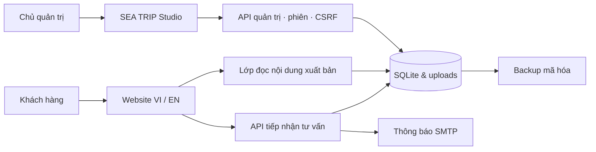

<div align="center">
  

# Du lịch được kể bằng trải nghiệm.<br/>Vận hành được xây bằng hệ thống.

**SEA TRIP TRAVEL · Website du lịch & không gian quản trị**

Next.js 16 · React 19 · TypeScript · SQLite · Docker

[Khám phá website](https://sea-trip-travel.duckdns.org) · [Kiến trúc](docs/architecture.md) · [Triển khai](docs/CI-CD.md) · [Bảo mật](SECURITY.md)

</div>


## Từ khám phá điểm đến đến tiếp nhận khách hàng

SEA TRIP TRAVEL kết nối trải nghiệm xem tour với công việc vận hành của doanh nghiệp lữ hành. Khách hàng khám phá điểm đến, đọc lịch trình và gửi yêu cầu tư vấn. Đội ngũ vận hành quản lý nội dung, tiếp nhận lead và theo dõi nghiệp vụ trong **SEA TRIP Studio**.

Sản phẩm tập trung vào Quy Nhơn – Phú Yên và các tuyến du lịch trong nước. Phạm vi hiện tại là giới thiệu dịch vụ và tiếp nhận tư vấn; chưa tích hợp thanh toán hoặc xác nhận đặt chỗ tự động.

## Năng lực thể hiện trong sản phẩm

| Nhu cầu doanh nghiệp       | Giải pháp trong repository                                                                        |
| :------------------------- | :------------------------------------------------------------------------------------------------ |
| Trình bày sản phẩm du lịch | Trang điểm đến, danh mục, lịch trình tour, cẩm nang và thư viện hình ảnh                          |
| Chủ động cập nhật nội dung | Studio quản lý nội dung, nháp, xuất bản, media và cấu hình trang chủ                              |
| Tiếp nhận cơ hội bán hàng  | Form tư vấn, kiểm tra dữ liệu, chống spam, lưu lead và gửi thông báo SMTP                         |
| Hỗ trợ vận hành nội bộ     | Quản lý tài chính tour, hóa đơn và xuất PDF; xem [tài liệu nghiệp vụ](docs/ADMIN-TOUR-FINANCE.md) |
| Tiếp cận người đọc quốc tế | Giao diện VI/EN, trạng thái duyệt bản dịch, quy tắc index nội dung                                |
| Bàn giao có thể vận hành   | Docker, CI/CD, health endpoint theo commit, backup mã hóa và hướng dẫn phục hồi                   |

## Thiết kế để bảo trì và bàn giao

Ứng dụng dùng chung một nền tảng cho website và Studio. UI được tách khỏi lớp nghiệp vụ; nội dung xuất bản được đọc qua repository, còn dữ liệu quản trị lưu trên SQLite và volume bền vững.



| Thành phần           | Lựa chọn                                            |
| :------------------- | :-------------------------------------------------- |
| Ứng dụng             | Next.js App Router, React, TypeScript               |
| Giao diện            | Tailwind CSS, design tokens, chuyển động CSS        |
| Hợp đồng dữ liệu     | Schema Zod và validation phía server                |
| Nội dung & nghiệp vụ | SQLite, nội dung seed trong source, thư mục uploads |
| Triển khai           | Node.js 22, Docker Compose, Caddy, GitHub Actions   |

Mô hình triển khai hiện tại phù hợp **một VPS có ổ đĩa bền vững** và một chủ quản trị. Mở rộng nhiều instance cần đánh giá lại database, lưu trữ media và shared rate-limit store. Xem [kiến trúc](docs/architecture.md).

## Chất lượng có bằng chứng

Repository cung cấp các lớp kiểm tra có thể chạy lại, thay vì dựa vào số lượng test hoặc tuyên bố chất lượng cố định:

| Lớp kiểm tra        | Nội dung                                                                   |
| :------------------ | :------------------------------------------------------------------------- |
| Static checks       | ESLint, TypeScript và production build                                     |
| Unit & integration  | Validation, lead, email, nội dung, nghiệp vụ, CMS và backup                |
| Trình duyệt         | UI, CMS, nhập tour, hero, trình biên tập tour và SEO                       |
| Container & release | Build image, read-only filesystem, persistent volume, health và commit SHA |

```bash
npm run verify:preflight -- --full
```

Đây là cổng kiểm tra bắt buộc trước khi push. Thay đổi hạ tầng cần thêm Docker build và smoke test theo [quy trình CI/CD](docs/CI-CD.md). CI chạy trên PR; deploy production chỉ chạy từ main khi được cấu hình. Trạng thái thực tế xem tại [GitHub Actions](https://github.com/nvu-1801/sea-trip-travel/actions), không suy ra từ README.

## Bảo mật & dữ liệu khách hàng

Các kiểm soát trong source gồm mật khẩu quản trị băm bằng scrypt, phiên lưu dưới dạng hash, cookie HttpOnly/SameSite, kiểm tra Origin và CSRF cho thao tác quản trị, mã hóa payload lead bằng AES-256-GCM và giới hạn đăng nhập. Container ứng dụng chạy với filesystem chỉ đọc và không được cấp thêm quyền.

Bảo mật còn phụ thuộc cấu hình production, quản lý khóa và cập nhật dependency. [Chính sách bảo mật](SECURITY.md) mô tả cách báo cáo vấn đề; [báo cáo rà soát](docs/SECURITY-REVIEW.md) ghi bằng chứng và giới hạn đã biết. Đây không phải chứng nhận bảo mật hay kết quả pentest độc lập.

## Chạy tại máy phát triển

Yêu cầu **Node.js >= 22.13** và npm. Clone repository rồi chạy:

```bash
npm ci
cp .env.example .env.local
```

Trên PowerShell, dùng `Copy-Item .env.example .env.local`. Trong file riêng vừa tạo, đặt `LEAD_ENCRYPTION_KEY` và `LEAD_HASH_SALT` bằng hai giá trị ngẫu nhiên độc lập. Chạy lệnh sau hai lần, mỗi lần lấy một giá trị:

```bash
node -e "console.log(require('node:crypto').randomBytes(32).toString('hex'))"
```

Để `MAIL_TRANSPORT=log` khi phát triển. Muốn thử gửi email, điền cấu hình SMTP và địa chỉ nhận của môi trường thử nghiệm vào `.env.local`.

```bash
npm run dev
```

Mở [localhost:3050](http://localhost:3050). Để dùng Studio, đặt `ADMIN_USERNAME` và `ADMIN_PASSWORD` (14–200 ký tự) trong môi trường riêng, rồi chạy `npm run admin -- bootstrap`. Không có mật khẩu mặc định. Hướng dẫn chi tiết: [CMS cho chủ website](docs/CMS-OWNER-GUIDE.md).

## Vận hành production

1. Tạo `.env.production` riêng trên VPS từ [template](.env.production.example); điền domain, SMTP và khóa, đặt quyền `600`.
2. Chuẩn bị volume bền vững cho SQLite/uploads và bản sao khóa mã hóa ngoài VPS.
3. Thực hiện release qua PR, CI và main; xác minh `/api/health` có `status: "ok"`, `database: "connected"` và đúng SHA.
4. Kiểm tra backup và diễn tập phục hồi trước khi nhận dữ liệu thực.

Không đưa file môi trường thật, dữ liệu khách, database hoặc backup vào Git. Không thay khóa mã hóa lead đang dùng nếu chưa có kế hoạch di chuyển dữ liệu.

## Tài liệu bàn giao

| Dành cho       | Tài liệu                                                                                                     |
| :------------- | :----------------------------------------------------------------------------------------------------------- |
| Chủ website    | [Sử dụng Studio](docs/CMS-OWNER-GUIDE.md) · [Nội dung cần bổ sung](docs/CONTENT-TODO.md)                     |
| Đội phát triển | [Kiến trúc](docs/architecture.md) · [Design tokens](docs/design-tokens.md) · [Luồng lead](docs/lead-flow.md) |
| Đội vận hành   | [VPS & Docker](docs/VPS-DEPLOY.md) · [CI/CD](docs/CI-CD.md) · [Backup & restore](docs/BACKUP-RESTORE.md)     |
| Biên tập       | [Vận hành VI/EN](docs/I18N_GUIDE.md) · [Duyệt bản dịch](docs/I18N_CONTENT_REVIEW.md)                         |
| Nghiệp vụ      | [Tài chính tour](docs/ADMIN-TOUR-FINANCE.md) · [Hóa đơn](docs/invoices.md)                                   |
| Nghiệm thu     | [Checklist](docs/acceptance-checklist.md) · [Bảo mật](docs/SECURITY-REVIEW.md)                               |

Một số tài liệu kế hoạch lưu lại phạm vi ở thời điểm viết. Khi có khác biệt, đối chiếu source, test và quy trình vận hành hiện hành trước khi triển khai.
